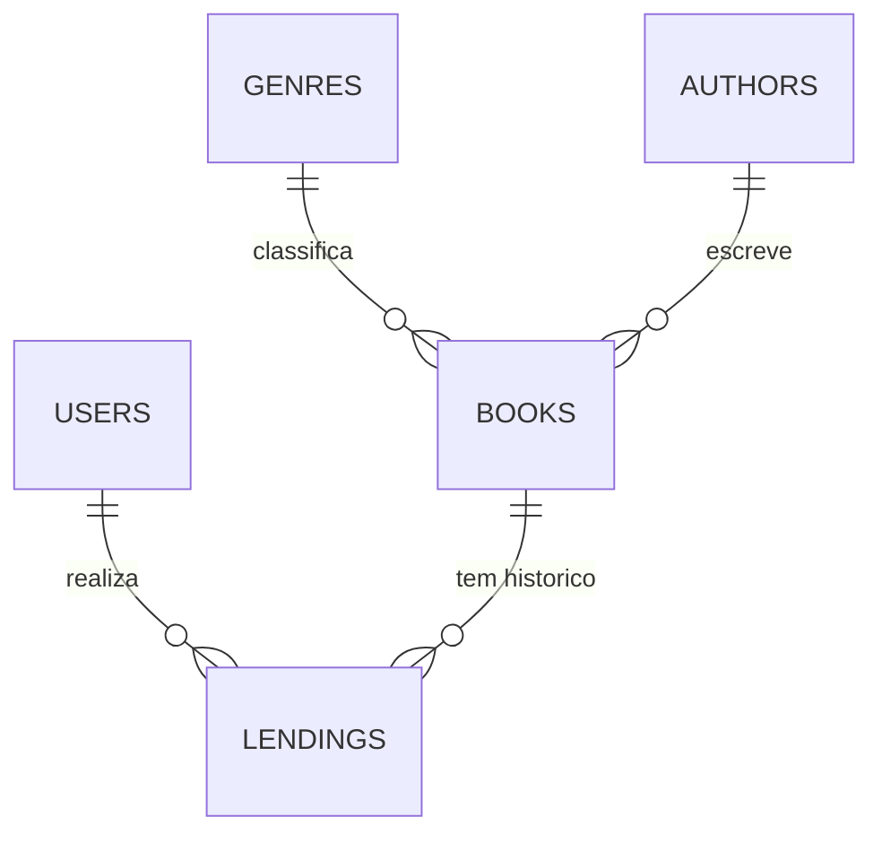

# Modelo de dados e seed

Entidades JPA, tabelas e colunas do H2, relação com o DER da especificação e os dados iniciais (`data.sql`).

## Sumário

- [Como o banco funciona](#como-o-banco-funciona)
- [Diagrama](#diagrama)
- [Entidades e tabelas](#entidades-e-tabelas)
- [DDL gerado pelo Hibernate](#ddl-gerado-pelo-hibernate)
- [Relacionamentos e multiplicidades](#relacionamentos-e-multiplicidades)
- [DER da especificação x código](#der-da-especificação-x-código)
- [Campos calculados (não são colunas)](#campos-calculados-não-são-colunas)
- [Seed](#seed)
- [Alterando o modelo ou o seed](#alterando-o-modelo-ou-o-seed)

## Como o banco funciona

| Item | Valor |
| --- | --- |
| Banco | H2 **em memória** (`jdbc:h2:mem:library`), usuário e senha `admin` no `application.properties` |
| Schema | Gerado pelo Hibernate na subida (`spring.jpa.hibernate.ddl-auto=update`). Não há Flyway nem Liquibase |
| Seed | `src/main/resources/data.sql`, executado depois do schema (`spring.sql.init.mode=always` + `spring.jpa.defer-datasource-initialization=true`, encoding UTF-8) |
| Persistência | Nenhuma: tudo que for cadastrado some quando a aplicação para. A cada subida o banco nasce novo e o seed é reaplicado |
| Dialeto | `org.hibernate.dialect.H2Dialect` |

Como o banco é recriado a cada subida, os ids voltam a começar de 1 e o seed, cujas datas são relativas a `CURRENT_DATE`, sempre reflete o dia em que a aplicação subiu.

## Diagrama



Lado "muitos" das relações: `lendings` guarda `user_id` e `book_id`; `books` guarda `author_id` e `genre_id`. A multiplicidade `1..*` da especificação para Autor — Livro é aplicada como `0..*`; veja [Relacionamentos](#relacionamentos-e-multiplicidades).

## Entidades e tabelas

As colunas seguem a convenção do Spring (camelCase vira snake_case: `publishDate` vira `publish_date`). Todas as entidades usam `Long id` com `@GeneratedValue(strategy = IDENTITY)`.

### `Author` — tabela `authors`

| Coluna | Tipo | Nulo | Observação |
| --- | --- | --- | --- |
| `id` | `bigint` identity | não | PK |
| `name` | `varchar(255)` | não | |

### `Genre` — tabela `genres`

| Coluna | Tipo | Nulo | Observação |
| --- | --- | --- | --- |
| `id` | `bigint` identity | não | PK |
| `name` | `varchar(255)` | não | |

### `Book` — tabela `books`

| Coluna | Tipo | Nulo | Observação |
| --- | --- | --- | --- |
| `id` | `bigint` identity | não | PK |
| `title` | `varchar(255)` | não | |
| `author_id` | `bigint` | não | FK para `authors` |
| `genre_id` | `bigint` | não | FK para `genres` |
| `publish_date` | `date` | não | `LocalDate` |
| `publisher` | `varchar(255)` | não | |

### `User` — tabela `users`

O nome da tabela é `users` (e não `user`) para fugir da palavra reservada.

| Coluna | Tipo | Nulo | Observação |
| --- | --- | --- | --- |
| `id` | `bigint` identity | não | PK |
| `name` | `varchar(255)` | não | |
| `cpf` | `varchar(11)` | não | Somente dígitos; `UNIQUE` |

### `Lending` — tabela `lendings`

| Coluna | Tipo | Nulo | Observação |
| --- | --- | --- | --- |
| `id` | `bigint` identity | não | PK |
| `start_date` | `date` | não | Data do empréstimo |
| `end_date` | `date` | não | Data **prevista** da devolução |
| `return_date` | `date` | **sim** | Data **efetiva** da devolução; nula enquanto em aberto |
| `user_id` | `bigint` | não | FK para `users` |
| `book_id` | `bigint` | não | FK para `books` |

O status do empréstimo (`ATIVO`, `ATRASADO`, `CONCLUIDO`) **não** é uma coluna: veja [Campos calculados](#campos-calculados-não-são-colunas).

## DDL gerado pelo Hibernate

Obtido subindo a aplicação com `--logging.level.org.hibernate.SQL=DEBUG` (os nomes das constraints são gerados pelo Hibernate e podem variar):

```sql
create table authors (id bigint generated by default as identity, name varchar(255) not null, primary key (id));
create table books (id bigint generated by default as identity, publish_date date not null, publisher varchar(255) not null, title varchar(255) not null, author_id bigint not null, genre_id bigint not null, primary key (id));
create table genres (id bigint generated by default as identity, name varchar(255) not null, primary key (id));
create table lendings (id bigint generated by default as identity, end_date date not null, return_date date, start_date date not null, book_id bigint not null, user_id bigint not null, primary key (id));
create table users (id bigint generated by default as identity, cpf varchar(11) not null, name varchar(255) not null, primary key (id));

alter table users add constraint ... unique (cpf);
alter table books add constraint ... foreign key (author_id) references authors;
alter table books add constraint ... foreign key (genre_id) references genres;
alter table lendings add constraint ... foreign key (book_id) references books;
alter table lendings add constraint ... foreign key (user_id) references users;
```

Nenhuma FK tem `ON DELETE CASCADE`, e as relações JPA não usam `cascade`: apagar uma linha referenciada falha no banco (a API antecipa isso com `409`, veja [regras de negócio](../regras/regras-de-negocio.md#exclusões-bloqueadas-e-histórico)).

## Relacionamentos e multiplicidades

| Relação (especificação, seção 4) | Implementação |
| --- | --- |
| Usuário `1` — `0..*` Empréstimo | `Lending.user` `@ManyToOne(optional = false)`, coluna `user_id NOT NULL` |
| Empréstimo `0..*` — `1` Livro | `Lending.book` `@ManyToOne(optional = false)`, coluna `book_id NOT NULL`. O histórico do livro é a lista de seus empréstimos |
| Livro `0..*` — `1` Gênero | `Book.genre` `@ManyToOne(optional = false)`, coluna `genre_id NOT NULL`. Gênero sem livros é permitido |
| Livro `1..*` — `1` Autor | `Book.author` `@ManyToOne(optional = false)`, coluna `author_id NOT NULL` garante "um livro tem exatamente um autor". A parte "todo autor tem ao menos um livro" **não é imposta pelo banco nem pela API** (desvio controlado, veja [regras de negócio](../regras/regras-de-negocio.md#autor-sem-livros)); o seed respeita |
| "O empréstimo ocorre somente sem pendências" (anotação) | Regra de serviço em `LendingService.createLending`, não é restrição de banco |

Regras de integridade adicionais, também no serviço (veja [regras de negócio](../regras/regras-de-negocio.md)): um empréstimo em aberto por livro, histórico do livro sem sobreposição e exclusões bloqueadas.

## DER da especificação x código

A especificação (seção 6) descreve o DER em português; o código usa nomes em inglês. Detalhes e justificativas em [conformidade.md](../specs/conformidade.md).

| DER | Classe / tabela | Atributo do DER | Campo no código | Coluna |
| --- | --- | --- | --- | --- |
| Usuario | `User` / `users` | id | `id` | `id` |
| | | nome | `name` | `name` |
| | | cpf | `cpf` | `cpf` |
| Emprestimo | `Lending` / `lendings` | id | `id` | `id` |
| | | dataInicio | `startDate` | `start_date` |
| | | dataFim | `endDate` (prevista) e `returnDate` (efetiva) | `end_date`, `return_date` |
| | | usuario | `user` | `user_id` |
| | | livro | `book` | `book_id` |
| Livro | `Book` / `books` | id | `id` | `id` |
| | | nome | `title` | `title` |
| | | autor | `author` | `author_id` |
| | | genero | `genre` | `genre_id` |
| | | dataPublicacao | `publishDate` (no frontend: `publicationDate`) | `publish_date` |
| | | editora | `publisher` | `publisher` |
| Genero | `Genre` / `genres` | id, nome | `id`, `name` | `id`, `name` |
| Autor | `Author` / `authors` | id, nome | `id`, `name` | `id`, `name` |

Diferenças em relação ao DER: `id` é `Long`/`bigint` (a especificação cita `int`); as datas são `LocalDate`; `dataFim` foi dividida em prazo (`endDate`) e devolução efetiva (`returnDate`).

## Campos calculados (não são colunas)

| Campo | Onde aparece | Como é calculado |
| --- | --- | --- |
| `status` | Empréstimo | `LendingStatus.of`: `CONCLUIDO` se há `returnDate`; senão `ATRASADO` se hoje é depois de `endDate`; senão `ATIVO` |
| `available` | Livro | Não existe empréstimo em aberto (`return_date IS NULL`) do livro |
| `debtFree` | Usuário | Não existe empréstimo em aberto com `end_date` anterior a hoje |
| `bookCount` | Autor e gênero | Quantidade de linhas de `books` com aquele `author_id` / `genre_id` |

## Seed

`data.sql` popula o banco a cada subida. Os ids são gerados pelo banco na ordem dos `INSERT`s, e as chaves estrangeiras são resolvidas por subselect (por nome, CPF ou título), então **a ordem do arquivo define os ids**.

### Contagens

| Recurso | Quantidade | Ids |
| --- | --- | --- |
| Autores | 12 | 1 a 12 |
| Gêneros | 9 | 1 a 9 |
| Livros | 20 | 1 a 20 |
| Usuários | 10 | 1 a 10 |
| Empréstimos | 14 | 1 a 14 |

Os 8 primeiros autores, 7 primeiros gêneros, 10 primeiros livros, 8 primeiros usuários e 7 primeiros empréstimos são os mesmos do mock do frontend. Os demais foram acrescentados para cobrir mais casos.

### Autores e gêneros

Autores: 1 Machado de Assis, 2 Clarice Lispector, 3 Jorge Amado, 4 J.R.R. Tolkien, 5 George Orwell, 6 Gabriel García Márquez, 7 Isaac Asimov, 8 Agatha Christie, 9 Graciliano Ramos, 10 Aldous Huxley, 11 Mary Shelley, 12 Cecília Meireles. Todo autor tem pelo menos um livro.

Gêneros (com a quantidade de livros): 1 Romance (3), 2 Ficção Científica (2), 3 Literatura Brasileira (5), 4 Fantasia (2), 5 Distopia (3), 6 Mistério e Suspense (2), 7 Realismo Mágico (1), 8 Terror (1), 9 Poesia (1).

### Livros

| Id | Título | Autor | Gênero | Publicação |
| --- | --- | --- | --- | --- |
| 1 | Dom Casmurro | Machado de Assis | Literatura Brasileira | 1899-01-01 |
| 2 | A Hora da Estrela | Clarice Lispector | Romance | 1977-10-26 |
| 3 | Capitães da Areia | Jorge Amado | Literatura Brasileira | 1937-01-01 |
| 4 | O Hobbit | J.R.R. Tolkien | Fantasia | 1937-09-21 |
| 5 | 1984 | George Orwell | Distopia | 1949-06-08 |
| 6 | Cem Anos de Solidão | Gabriel García Márquez | Realismo Mágico | 1967-05-30 |
| 7 | Fundação | Isaac Asimov | Ficção Científica | 1951-06-01 |
| 8 | E Não Sobrou Nenhum | Agatha Christie | Mistério e Suspense | 1939-11-06 |
| 9 | Memórias Póstumas de Brás Cubas | Machado de Assis | Literatura Brasileira | 1881-01-01 |
| 10 | A Revolução dos Bichos | George Orwell | Distopia | 1945-08-17 |
| 11 | Vidas Secas | Graciliano Ramos | Literatura Brasileira | 1938-01-01 |
| 12 | São Bernardo | Graciliano Ramos | Literatura Brasileira | 1934-01-01 |
| 13 | Admirável Mundo Novo | Aldous Huxley | Distopia | 1932-01-01 |
| 14 | Frankenstein | Mary Shelley | Terror | 1818-01-01 |
| 15 | Romanceiro da Inconfidência | Cecília Meireles | Poesia | 1953-01-01 |
| 16 | O Senhor dos Anéis: A Sociedade do Anel | J.R.R. Tolkien | Fantasia | 1954-07-29 |
| 17 | Eu, Robô | Isaac Asimov | Ficção Científica | 1950-12-02 |
| 18 | Assassinato no Expresso do Oriente | Agatha Christie | Mistério e Suspense | 1934-01-01 |
| 19 | Gabriela, Cravo e Canela | Jorge Amado | Romance | 1958-01-01 |
| 20 | A Paixão Segundo G.H. | Clarice Lispector | Romance | 1964-01-01 |

Livros sem nenhum empréstimo (podem ser excluídos): 12, 15, 16, 17, 18, 19 e 20. Livros hoje emprestados (`available: false`): 1, 3, 4, 5, 6, 8 e 13.

### Usuários

Os CPFs são fictícios e gravados só com dígitos.

| Id | Nome | CPF | Pendência |
| --- | --- | --- | --- |
| 1 | Ana Souza | 12345678901 | não |
| 2 | Bruno Oliveira | 23456789012 | **sim** (empréstimo 8) |
| 3 | Carla Mendes | 34567890123 | não |
| 4 | Diego Ferreira | 45678901234 | não |
| 5 | Elena Rostova | 56789012345 | **sim** (empréstimo 4) |
| 6 | Fernando Silva | 67890123456 | não |
| 7 | Gabriela Lima | 78901234567 | não |
| 8 | Heitor Costa | 89012345678 | **sim** (empréstimo 6) |
| 9 | Isabela Rocha | 90123456789 | não (sem empréstimos, pode ser excluída) |
| 10 | João Pereira | 01234567890 | não (sem empréstimos, pode ser excluído) |

### Empréstimos (datas relativas a hoje)

As datas usam `DATEADD('DAY', n, CURRENT_DATE)`, então a coluna mostra o deslocamento em dias em relação ao dia da subida. Assim sempre existem empréstimos nos três status, em qualquer data.

| Id | Usuário | Livro | Status | `start_date` | `end_date` | `return_date` |
| --- | --- | --- | --- | --- | --- | --- |
| 1 | Ana Souza | Dom Casmurro | ATIVO | hoje -3 | hoje +11 | |
| 2 | Bruno Oliveira | A Hora da Estrela | CONCLUIDO | -60 | -46 | -50 |
| 3 | Carla Mendes | Capitães da Areia | ATIVO | -6 | +8 | |
| 4 | Elena Rostova | 1984 | ATRASADO | -30 | -16 | |
| 5 | Fernando Silva | O Hobbit | ATIVO | -1 | +13 | |
| 6 | Heitor Costa | E Não Sobrou Nenhum | ATRASADO | -25 | -11 | |
| 7 | Diego Ferreira | Fundação | CONCLUIDO | -90 | -76 | -78 |
| 8 | Bruno Oliveira | Cem Anos de Solidão | ATRASADO | -20 | -6 | |
| 9 | Elena Rostova | Memórias Póstumas de Brás Cubas | CONCLUIDO | -75 | -61 | -62 |
| 10 | Heitor Costa | Vidas Secas | CONCLUIDO | -45 | -31 | -33 |
| 11 | Gabriela Lima | Admirável Mundo Novo | ATIVO | 0 | +14 | |
| 12 | Ana Souza | A Revolução dos Bichos | CONCLUIDO | -40 | -26 | -28 |
| 13 | Diego Ferreira | Frankenstein | CONCLUIDO (devolvido com atraso) | -35 | -21 | -15 |
| 14 | Gabriela Lima | Dom Casmurro | CONCLUIDO | -70 | -56 | -57 |

Totais: 4 `ATIVO` (1, 3, 5, 11), 3 `ATRASADO` (4, 6, 8) e 7 `CONCLUIDO` (2, 7, 9, 10, 12, 13, 14).

### Regras que o seed respeita

- Nenhum livro tem dois empréstimos em aberto ao mesmo tempo.
- Os únicos usuários com empréstimo `ATRASADO` (portanto com pendência) são Bruno Oliveira, Elena Rostova e Heitor Costa, como no mock do frontend.
- Esses três também têm histórico `CONCLUIDO`.
- Nenhum empréstimo de um mesmo livro se sobrepõe a outro (o empréstimo 14 de Dom Casmurro termina antes de o 1 começar).
- Todo autor tem pelo menos um livro, todo livro tem autor e gênero, e todo CPF tem 11 dígitos.

`SeedDataTest` confere várias delas: quantidades, status relativos a hoje, usuários com pendência (e histórico concluído), livros indisponíveis, CPFs só com dígitos e autores com livro.

## Alterando o modelo ou o seed

- Ao mudar uma entidade, atualize o `data.sql`, os DTOs, os testes e este documento. Não existe migração: o schema é recriado a cada subida.
- Mantenha no seed as regras acima; se criar empréstimos novos, use datas relativas (`CURRENT_DATE`) e respeite a disponibilidade e a pendência.
- Para o `data.sql` ser lido com acentos corretos, o encoding UTF-8 já está configurado (`spring.sql.init.encoding=UTF-8`); mantenha o arquivo em UTF-8.
- Os ids dependem da ordem dos `INSERT`s. Ao inserir linhas no meio do arquivo, os ids seguintes mudam: confira os testes e o frontend antes. Prefira acrescentar no final.
